# Moneta

**Moneta** é um app pessoal — instalável no celular como PWA — para centralizar **despesas
pessoais e de trabalho**, **lembretes de saúde** e **agenda** num só lugar, com **rotinas**
que avisam você na hora certa.

Este repositório é o **frontend** (React + Vite) e também o ponto de entrada do projeto: aqui
está o `docker-compose.yml` que sobe tudo localmente.

| Repositório | O que é |
|---|---|
| **[moneta-frontend](https://github.com/aislanmiranda/moneta-frontend)** (este) | PWA em React — telas, notificações no aparelho, docker-compose do projeto |
| [moneta-backend](https://github.com/aislanmiranda/moneta-backend) | API ASP.NET Core + PostgreSQL — contas, módulos, lançamentos, rotinas, notificações em tempo real |
| [moneta-schedule](https://github.com/aislanmiranda/moneta-schedule) | Worker .NET (Quartz) — executa as rotinas e gera os lembretes |

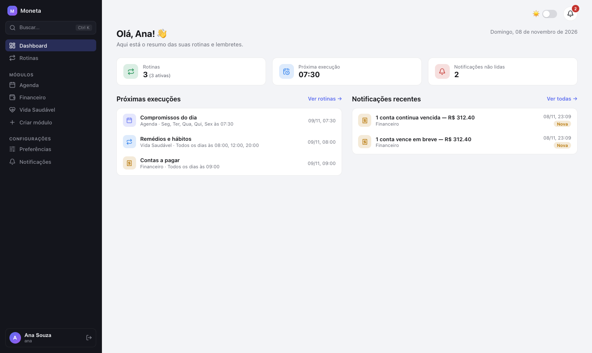

## Para que serve

- **Financeiro** — contas a pagar pessoais e de trabalho no mesmo lugar (com filtro
  Pessoal/Trabalho), por centro de custo (você, casa, mãe…) e categoria. Lançamentos únicos,
  **previstos** em dias ou meses, ou **indeterminados** (o próximo mês é criado quando você
  marca o atual como pago). Cada lançamento aceita **observação** e **comprovantes** (PDF/imagem).
- **Vida Saudável** — remédios, água, academia ou qualquer tipo que você cadastrar, com
  horários recorrentes; o app gera as ocorrências do dia para você marcar como feitas.
- **Agenda** — compromissos com data e hora.
- **Rotinas** — agendamentos (cron simples ou avançado) que verificam um módulo e notificam:
  contas que vencem em breve / vencem hoje / continuam vencidas, remédios pendentes, etc.
- **Notificações** em tempo real (SignalR) no sino do app e como notificação do aparelho.
- **Contas de usuário** — cada pessoa vê só os próprios dados. Senha de 6 números com teclado
  numérico no celular.
- **Configuração por módulo** — centros de custo, pessoas, categorias e tipos (com ícone)
  editáveis.
- Tema claro e escuro; layout responsivo; instalável no celular.

## Visão geral

| | |
|---|---|
| 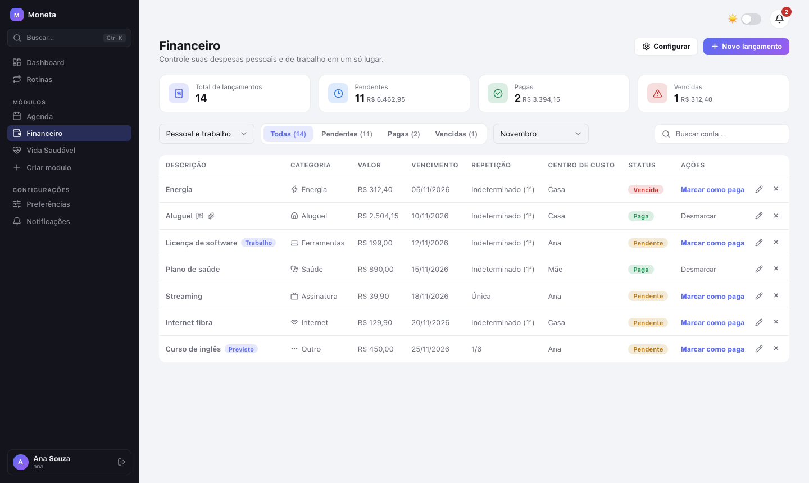 | 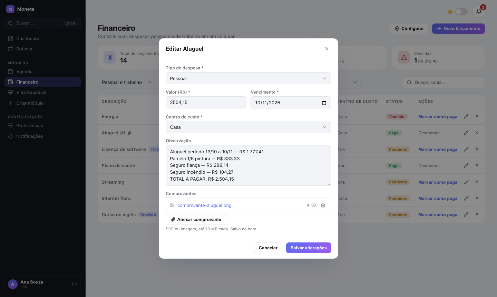 |
| **Financeiro** — pessoal e trabalho, status, recorrência | **Lançamento** — observação e comprovante anexado |
| 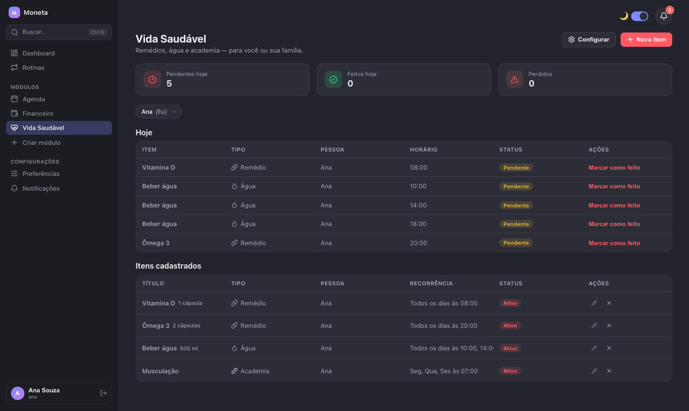 | 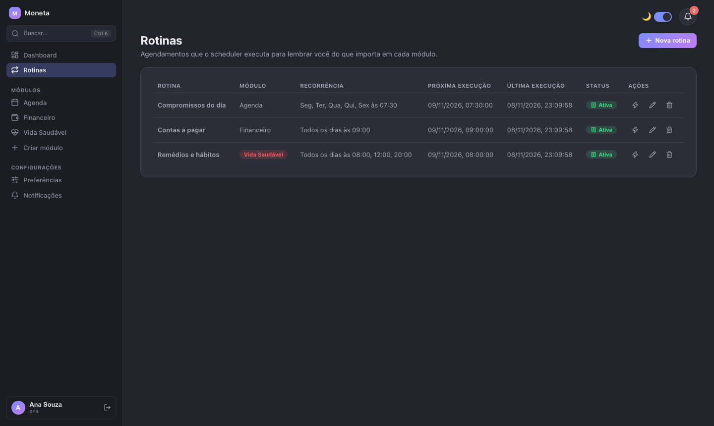 |
| **Vida Saudável** (tema escuro) | **Rotinas** — próxima e última execução |
| 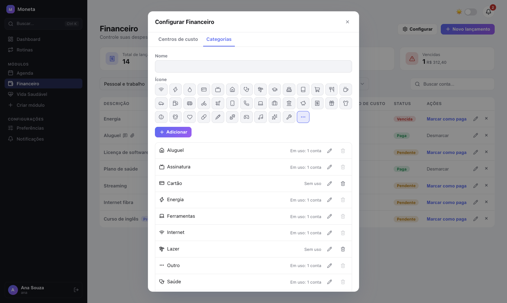 | 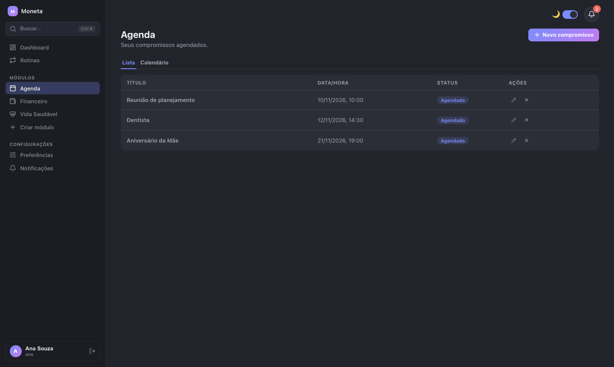 |
| **Configurar** — categorias com ícone | **Agenda** |

<p align="center">
  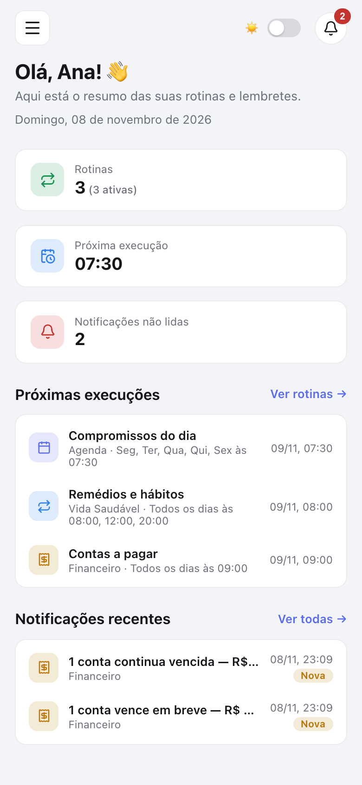
  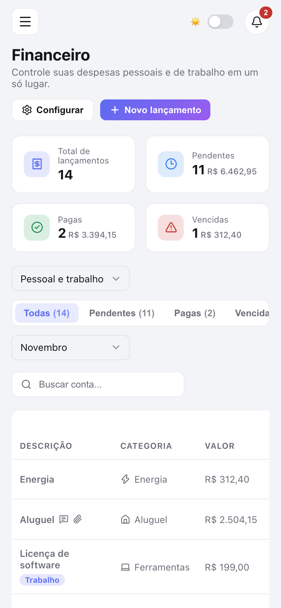
  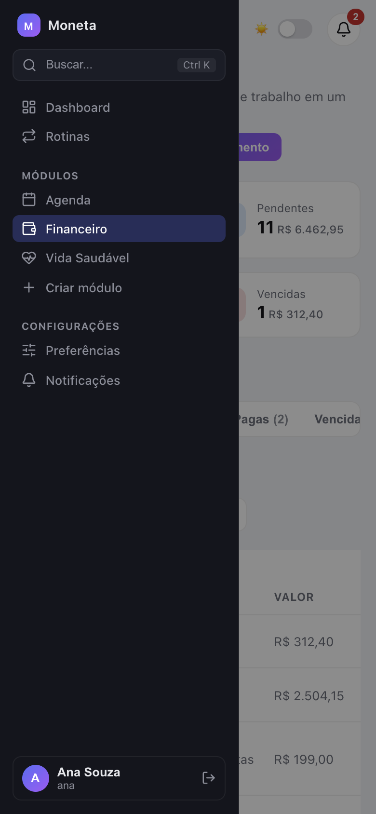
</p>

## Arquitetura

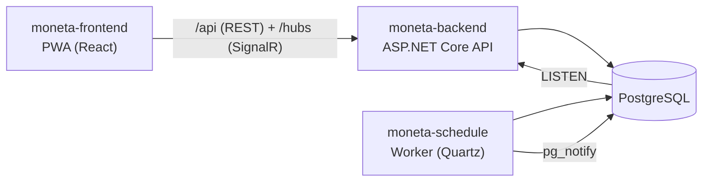

- O **frontend** chama a API sempre na mesma origem (`/api`, `/hubs`): em desenvolvimento o
  Vite faz o proxy, no Docker o nginx do container.
- O **schedule** lê as rotinas do banco, executa nos horários configurados, grava as
  notificações e avisa a API via `pg_notify`; a API repassa por SignalR só para o dono.
- Os dois processos .NET compartilham o modelo de dados (o schedule referencia os projetos do
  backend) e nunca chamam um ao outro diretamente.

## Rodando localmente (Docker)

Pré-requisitos: Docker com Compose v2.

```bash
# 1. Clone os três repositórios lado a lado
git clone https://github.com/aislanmiranda/moneta-frontend.git
git clone https://github.com/aislanmiranda/moneta-backend.git
git clone https://github.com/aislanmiranda/moneta-schedule.git

# 2. Configure a chave de login
cd moneta-frontend
cp .env.example .env
echo "AUTH_JWT_KEY=$(openssl rand -base64 48)" >> .env

# 3. Suba tudo
docker compose up -d --build
```

Abra **http://localhost:8080** e clique em **Criar conta**. Cada conta nasce com os módulos
Financeiro, Vida Saudável e Agenda.

O compose sobe, nesta ordem: `postgres` → `migrate` (aplica as migrations) → `backend` (API em
`:5080`) → `schedule` e `frontend` (nginx em `:8080`). O arquivo está em
[`docker-compose.yml`](docker-compose.yml) e as variáveis opcionais em
[`.env.example`](.env.example):

| Variável | Padrão | Para quê |
|---|---|---|
| `AUTH_JWT_KEY` | — (obrigatória) | Chave de assinatura do login (mín. 32 caracteres) |
| `POSTGRES_PASSWORD` | `moneta` | Senha do Postgres |
| `POSTGRES_PORT` | `5432` | Porta do Postgres no seu computador |
| `FRONTEND_PORT` | `8080` | Porta do app |
| `TZ` | `America/Sao_Paulo` | Fuso usado para "hoje", horários e rotinas |
| `BACKEND_PATH` / `SCHEDULE_PATH` | `../moneta-backend` / `../moneta-schedule` | Onde estão os outros repositórios |

## Desenvolvimento do frontend

```bash
pnpm install
pnpm dev     # http://localhost:1420 — também exposto na rede local
```

O Vite faz proxy de `/api` e `/hubs` para `http://localhost:5080` (troque com
`BACKEND_URL=...`). Para rodar só o backend e o banco pelo Docker:
`docker compose up -d postgres migrate backend schedule`.

Stack: React 19, TypeScript, Vite, React Router, SignalR, `vite-plugin-pwa` (service worker
próprio em `src/sw.ts`), ícones `lucide-react`.

## Instalando no celular

Service worker e notificações exigem **HTTPS** (exceto em `localhost`). Pelo IP da rede local o
app abre, mas não instala nem notifica — exponha-o por HTTPS (ex.: `tailscale serve`, Cloudflare
Tunnel ou um proxy com certificado).

- **Android (Chrome):** menu ⋮ → Instalar app.
- **iPhone (Safari):** Compartilhar → Adicionar à Tela de Início. Notificações só funcionam
  abrindo pelo ícone instalado (iOS 16.4+).

Depois, ative as notificações em **Configurações → Notificações**. Hoje elas chegam com o app
aberto (SignalR); push com o app fechado ainda não está implementado.

## Licença

[MIT](LICENSE)
